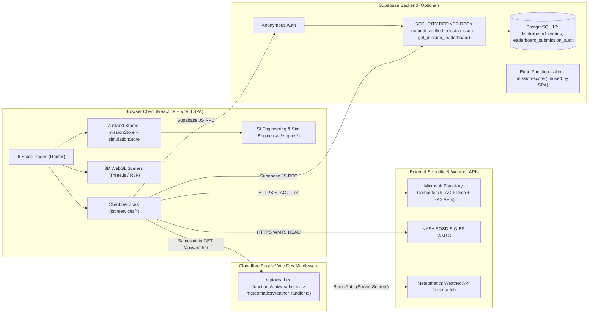

# GO / NO-GO (GNG) — Definitive Technical Reference (`PROJECT.md`)

> **Audit Basis**: This document reflects the actual implementation inspected across `/workspaces/Go-No-Go` as of 2026-11-15. Where documentation (`AIM.md`, `README.md`), database schemas, or conditional code branches diverge from the active runtime application, those differences are explicitly noted.

---

## Section A — Product Purpose and Executive Overview

### What GO / NO-GO Is
**GO / NO-GO (GNG)** is a browser-based spacecraft mission design, coupled systems-engineering verification, flight-readiness review, and orbital operations simulator built with React 19, TypeScript, Three.js (`@react-three/fiber` / `@react-three/drei`), Zustand v5, Tailwind CSS v4, and optional Supabase + Cloudflare Pages Functions backends.

### Problem It Addresses & Why It Exists
Spacecraft mission engineering is inherently coupled: adding a high-power instrument increases mass, which shrinks launch margin, increases solar array and battery sizing, raises thermal dissipation, strains link budgets, and consumes cost reserve. Traditional educational tools or games isolate these domains. GO / NO-GO unifies them into an inspectable, deterministic **Design → Verify → Launch → Operate → Debrief** loop grounded in SI units, NASA Concept Maturity Levels (CML 1–6), NPR 7120.5F / 8705.4B / NASA-STD-8719.14 engineering heuristics, and explicit equation provenance.

### What Users Accomplish
Across six sequential stages in the web application (`Go-No-Go/`) following the core principle **"The system advises. The user decides."**:
1. **Stage 1 — Mission Briefing (`/`, `/briefing`)**: Starts on an **Earth-first** orbital scene with the Moon in the background (`showMoonInBackground = true`), with an interactive view toggle to inspect the destination body (`LUNAR SCOUT`, `MARS OBSERVER`, or `ASTEROID EXPLORER`). Users choose a mission scenario, difficulty profile (`STANDARD`, `HARD`, `EXPERT`), and optionally open native `<dialog>` modals for supporting Earth-observation context (Microsoft Planetary Computer STAC, NASA GIBS WMTS, and Meteomatics weather via `/api/weather`).
2. **Stage 2 — Spacecraft Architecture (`/architecture`, `/builder`)**: Assemble a spacecraft using **engineering planning sheets** (`PlanningSheetDiagram.tsx`) and educational selection cards (`EquipmentCard.tsx`) across 3 buses, 16 subsystems in 6 categories (Solar Array, Battery, Antenna, Propulsion, Thermal, Avionics), and 7 scientific instruments. Cards prioritize purpose, what it does, why it matters, advantages, limitations, compatibility, and NASA learning links—keeping numerical clutter in the engineering analysis and verification stages.
3. **Stage 3 — Orbit & Launch (`/orbit`)**: Select from 9 reference orbits or tune custom perigee, apogee, eccentricity, inclination, and analytical $J_2$ Sun-Synchronous inclination, and pair the spacecraft with one of 4 launch vehicles, with interactive `<TechTerm>` aerospace abbreviations (`ΔV`, `SSO`, etc.).
4. **Stage 4 — Engineering Verification (`/verification`)**: Review the **advisory** Flight Readiness Review (`ENG: GO`, `ENG: CAUTION`, `ENG: NO-GO`) across 7 CML 1–6 checklist gates, 10 structured `ValidationFinding` checks, and the `MissionAdvisorPanel`. Engineering `NO-GO` never locks the user out; the Mission Director makes the final **GO — Authorize Launch** or **NO-GO — Hold Launch** decision (with a native `<dialog>` risk acknowledgement confirmation when overriding an engineering `NO-GO`), triggering a full-viewport 5-phase cinematic launch sequence (`LaunchSequenceOverlay`).
5. **Stage 5 — Mission Operations (`/operations`, `/simulation`)**: Launches directly into an **automatic** frame-rate-independent fixed-timestep (`60 s` physics step) 3D orbital simulation with time-warp (`1x`–`1000x`), fast-forward (`+6h`, `+24h`), deterministic anomaly mitigation, and an optional collapsible `Advanced Controls` drawer for manual per-instrument toggles, duty-cycle mode switching, downlink bursts, orbit trim burns, safe mode, and heater overrides. Auto-transitions to `/debrief` upon mission completion or loss.
6. **Stage 6 — Mission Debrief (`/debrief`, `/report`)**: Inspect the normalized 100-point mission score (`35` Science / `25` Reliability & Completion / `15` Resource Efficiency / `15` Data & Comms / `10` Risk Management), engineering assessment vs. director authorization (`ENG` vs. `AUTH`), telemetry replay timeline, KPP matrix, formula inspector (`FormulaInspectorModal`), and optional **International Leaderboard** (`PROVISIONAL` vs. `VERIFIED`, or honest offline diagnostics when `.env` has placeholder credentials).

### Central Engineering & Simulation Objectives
- **Internal SI Physics**: All engineering models in `Go-No-Go/src/engine/` compute in SI units (`kg`, `m`, `s`, `m/s`, `W`, `J`, `N`, `K`, `Hz`, `bits`/`bytes`) with explicit UI display conversions.
- **Inspectable Provenance**: Equations are tagged as `PHYSICAL_LAW`, `ENGINEERING_APPROXIMATION`, or `GAMEPLAY_RULE` and exposed in `FormulaInspectorModal.tsx`. Hardware items carry `ILLUSTRATIVE` or `VERIFIED_SPEC` provenance tags.
- **Deterministic Reproducibility**: Orbital propagation (2-body + secular $J_2$), eclipse geometry, ground station AOS passes, battery energy balance, thermal balance, and Mulberry32 anomaly injection step deterministically at `FIXED_PHYSICS_DT_SECONDS = 60`.

### Vision vs. Actually Implemented Functionality
- **Original Vision (`AIM.md` & initial SQL migrations)**: Envisioned four scenarios including `FLOODWATCH` (Earth monsoon flood monitoring), a 4-role cooperative multiplayer console (`MISSION_DIRECTOR`, `FLIGHT_SYSTEMS`, `SCIENCE_LEAD`, `COMMS_OPS`) backed by `multiplayer_rooms`, saved configurations (`mission_configurations`), and an interactive Mission Advisor.
- **Actually Implemented Today**:
  - **Playable Scenarios**: `MISSION_SCENARIOS` in `src/data/scenarios.ts` contains **3 deep-space scenarios** (`LUNAR SCOUT` [default], `MARS OBSERVER`, `ASTEROID EXPLORER`). `FLOODWATCH` is **not** in `MISSION_SCENARIOS`, though conditional `FLOODWATCH` / `EARTH` logic, `FLOODWATCH_WEATHER_BASINS` (`weather.ts`), `supabase/seed.sql` rows, and Earth EO/Weather modals remain in the codebase (on Stage 1 Briefing, Earth EO/Weather modals fall back to `EARTH_REFERENCE_REGIONS`).
  - **Multiplayer & Saved Configs**: Cooperative multiplayer tables/RPCs (`20261114000001_cooperative_multiplayer_rls.sql`) and `mission_configurations` / `mission_reports` / `profiles` exist in Supabase migrations, but **no frontend UI or service calls them**; `AppShell` enforces strictly 6 single-player gameplay stages without a sidebar or save/load screens.
  - **Mission Advisor**: `src/engine/advisor.ts` and `src/components/MissionAdvisorPanel.tsx` are implemented, unit-tested (`advisor.test.ts`), and rendered on Stage 4 (`EngineeringVerification.tsx`) as part of the advisory verification surface.
  - **Leaderboard**: Fully implemented via `leaderboardService.ts`, `LeaderboardPanel.tsx`, and Supabase RPCs (`submit_verified_mission_score`, `get_mission_leaderboard`), recording browser-submitted scores as `PROVISIONAL` (`is_verified = false`) when Supabase env vars are configured, and rendering an honest offline state with the exact `supabaseConfigReason` diagnostic (e.g., when `.env` contains placeholder values) otherwise.

---

## Section B — Product Architecture

### High-Level System Architecture



### Core Data Flow (Design → Verification → Simulation → Debrief)

```mermaid
sequenceDiagram
    participant U as User
    participant MS as missionStore (Zustand)
    participant VAL as engine/validation.ts
    participant SIM as simulationStore + engine/simulation.ts
    participant SCR as engine/scoring.ts
    participant LB as leaderboardService + Supabase RPC

    U->>MS: Select Scenario, Difficulty, Bus, Subsystems, Instruments, Orbit, LV
    MS->>VAL: resolveMissionEntities() -> evaluateMissionEngineering()
    VAL-->>MS: EngineeringSummary (8 domains + 7 CML gates + 10 findings + overallStatus)
    alt overallStatus === "NO_GO"
        VAL-->>U: Advisory ENG: NO-GO + Risk Acknowledgement Dialog
        U->>MS: Confirm GO — Authorize Launch (with riskAcknowledged)
    else overallStatus is GO or CAUTION
        U->>MS: Authorize Launch (GO)
    end
    else overallStatus is "GO" or "CAUTION"
        U->>SIM: Launch Sequence -> initializeSimulation(seed)
        loop Fixed Timestep (dt = 60s)
            SIM->>SIM: stepSimulationState() (Keplerian + Eclipse + AOS + Power + Thermal + SSR + Anomalies)
        end
        U->>SCR: completeMissionAndGenerateReport()
        SCR-->>U: MissionScoreReport (35/25/15/15/10, Grade S..F, Outcome)
        opt Supabase Configured & Eligible
            U->>LB: submitVerifiedMissionScore()
            LB->>LB: Client validation + strip client verification flags
            LB-->>U: Server recomputation -> PROVISIONAL entry saved
        end
    end
```

### Architectural Layers
- **Frontend**: React 19.3.1 + TypeScript 5 + React Router 8.5.1 + Tailwind CSS v4 + Recharts 3.10.1 + Lucide React.
- **3D Visualization**: `three` (0.187.0), `@react-three/fiber`, `@react-three/drei`, wrapped in `SceneCanvasGuard` (`WebGLFallback.tsx`) with module-level texture/mesh caching and `prefers-reduced-motion` support.
- **State Management**: Two Zustand v5 stores (`useMissionStore` for design & derived engineering summary; `useSimulationStore` for fixed-timestep telemetry, events, replay snapshots, anomalies, and final `MissionScoreReport`). No `localStorage` persistence is used for mission state; only `gng_player_identity_v1` (pseudonymous leaderboard token/alias/country) uses `localStorage`, and EO/Weather provenance logs use `sessionStorage`.
- **Routing (`App.tsx`)**: Maps 6 stages with legacy route aliases:
  - `/` & `/briefing` → `MissionBriefing`
  - `/architecture` & `/builder` → `SpacecraftBuilder`
  - `/orbit` → `OrbitPlanner`
  - `/verification` → `EngineeringVerification`
  - `/operations` & `/simulation` → `MissionSimulation`
  - `/debrief` & `/report` → `MissionReport`
  - `*` → `<Navigate to="/" replace />`
- **Server-Side Functions & Dev Proxy**: `Go-No-Go/functions/api/weather.ts` delegates to `Go-No-Go/src/server/meteomaticsWeatherHandler.ts`, which enforces a 4-basin allowlist (`FLOODWATCH_WEATHER_BASINS`), 3 window modes (`current`, `forecast_24h`, `historical_24h`), rejects arbitrary coordinates/dates, reads `METEOMATICS_USERNAME` / `METEOMATICS_PASSWORD` from server runtime env, and caches for 30-minute slots in isolate memory + Cloudflare Edge Cache. Locally, `vite.config.js` mounts `/api/weather` during `vite dev` and returns a `503` diagnostic JSON during `vite preview`.
- **Database & Auth (`supabase/`)**: PostgreSQL 17 with RLS enabled on all tables. `leaderboard_entries` and `leaderboard_submission_audit` have all direct `anon`/`authenticated` privileges revoked; access is exclusively via `SECURITY DEFINER` RPCs `submit_verified_mission_score` and `get_mission_leaderboard`. Browser clients authenticate anonymously (`signInAnonymously()`) or fall back to a hashed pseudonymous `playerToken`.
- **Security Boundaries**:
  - `public/_headers` sets `X-Content-Type-Options: nosniff`, `X-Frame-Options: SAMEORIGIN`, `Referrer-Policy: strict-origin-when-cross-origin`, and restrictive `Permissions-Policy`.
  - Meteomatics credentials never leave the server/function runtime; error messages scrub `Basic ...` headers and credential strings.
  - Planetary Computer SAS tokens live only in transient JS `Map` memory (never `localStorage` or Zustand).
  - Client-supplied `isVerified` / `verificationStatus` fields are stripped in `leaderboardService.ts` and ignored by PostgreSQL, which always records browser submissions as `PROVISIONAL`.
- **Error Handling & Offline Behavior**:
  - Missing Supabase env vars or placeholder values (`supabaseClient.ts`) cleanly set `isSupabaseConfigured = false`; `LeaderboardPanel` displays an offline banner with zero fabricated entries.
  - Planetary Computer, NASA GIBS, and `/api/weather` failures never throw uncaught errors; each returns explicit `OFFLINE_FALLBACK`, `UNCONFIGURED`, `RATE_LIMITED`, or `UNAVAILABLE` states and falls back to scenario baseline cloud fractions.
  - WebGL unavailability or context loss triggers `SceneCanvasGuard` numeric fallback cards.

---

## Section C — Complete Directory and File Reference

### Repository Directory Tree

```text
/workspaces/Go-No-Go/
├── .git/                              [EXCLUDED — Git repository metadata]
├── .gitignore                         [Active — Root Git ignore rules]
├── AIM.md                             [Active — Authoritative competition/product vision]
├── DIFF.md                            [Deliverable — AIM vs codebase reconciliation]
├── HostingGuide.md                    [Deliverable — Build, deploy, preview & hosting guide]
├── LICENSE                            [Active — MIT License (2026 Vivaan Satija)]
├── PROJECT.md                         [Deliverable — This technical reference]
├── README.md                          [Active — Workspace survey & reference guide]
├── SUBMISSION.md                      [Deliverable — Competition submission document]
├── node_modules/                      [EXCLUDED — Root npm dependencies (supabase CLI)]
├── package-lock.json                  [Active — Root npm lockfile]
├── package.json                       [Active — Root devDependency: supabase ^3.1.0]
├── Resources/
│   └── mission-viz/                   [External Submodule — NASA mission-viz reference repo]
├── supabase/
│   ├── .gitignore                     [Active — Supabase local temp/env ignore]
│   ├── config.toml                    [Active — Local Supabase project config (PG 17)]
│   ├── seed.sql                       [Active — Seeds 4 mission rows into public.missions]
│   ├── functions/
│   │   └── submit-mission-score/
│   │       └── index.ts               [Historical/Unused by SPA — Deno Edge Function proxy]
│   └── migrations/
│       ├── 20261114000000_initial_gng_schema.sql
│       ├── 20261114000001_cooperative_multiplayer_rls.sql
│       ├── 20261114000002_international_leaderboard.sql
│       └── 20261115000000_provisional_leaderboard_verification.sql
└── Go-No-Go/
    ├── .dev.vars                      [EXCLUDED/Gitignored — Local Cloudflare secrets]
    ├── .env                           [EXCLUDED/Gitignored — Local Vite env]
    ├── .gitignore                     [Active — App Git ignore rules]
    ├── .oxlintrc.json                 [Active — Oxlint configuration]
    ├── dist/                          [EXCLUDED — Vite production build output]
    ├── node_modules/                  [EXCLUDED — App npm dependencies]
    ├── test-results/                  [EXCLUDED — Playwright test output]
    ├── tsconfig.tsbuildinfo           [EXCLUDED — Generated TypeScript incremental cache]
    ├── index.html                     [Active — SPA HTML entry]
    ├── package-lock.json              [Active — App npm lockfile]
    ├── package.json                   [Active — App scripts & dependencies]
    ├── playwright.config.ts           [Active — Playwright E2E configuration]
    ├── tsconfig.json                  [Active — Strict TypeScript compiler config]
    ├── vite.config.js                 [Active — Vite 8, Tailwind v4, chunks, /api/weather proxy, Vitest]
    ├── wrangler.toml                  [Active — Cloudflare Pages configuration]
    ├── functions/api/weather.ts       [Active — Cloudflare Pages Function for /api/weather]
    ├── public/                        [Active — Static assets, _headers, manifest, models, textures]
    ├── scripts/stage-assets.mjs       [Active — Asset staging & Triana X3D-to-JSON converter]
    ├── src/
    │   ├── App.tsx, main.tsx, vite-env.d.ts
    │   ├── styles/global.css
    │   ├── types/ (8 files)
    │   ├── data/ (6 files)
    │   ├── engine/ (15 files)
    │   ├── store/ (2 files)
    │   ├── services/ (5 files)
    │   ├── server/meteomaticsWeatherHandler.ts
    │   ├── scenes/ (6 files)
    │   ├── components/ (12 files)
    │   └── pages/ (6 files)
    └── tests/
        ├── unit/ (8 files)
        ├── integration/missionSimulation.test.ts
        └── e2e/missionFlow.spec.ts
```

### Excluded Directories & Files
- **`.git/`**: Git internal object/ref database. Excluded from file-by-file documentation.
- **`node_modules/`** (root and `Go-No-Go/node_modules/`): Third-party npm packages installed locally. Excluded.
- **`Go-No-Go/dist/`**: Generated Vite production bundle (`tsc -b && vite build`). Excluded.
- **`Go-No-Go/test-results/`**: Generated Playwright artifacts. Excluded.
- **`Go-No-Go/tsconfig.tsbuildinfo`**: Generated TypeScript incremental build cache. Excluded.
- **`Go-No-Go/.env` & `Go-No-Go/.dev.vars`**: Gitignored local environment/secret files. Intentionally unread to prevent secret exposure.
- **`Resources/mission-viz/`**: Git submodule (`160000 c6f22701dc5fc3bf25172557a46557b1b5481eec`) containing NASA's open-source `OntologyDrivenOrrery/`, `RMarkdown/`, `X3Dom/`, `README.md`, and `index.html`. Its internal source files are third-party NASA reference material; `stage-assets.mjs` extracts `X3Dom/TrianaSatellite.x3d`, `X3Dom/EarthImage.jpg`, and `X3Dom/Moon_Flat.jpg` into `Go-No-Go/public/`.

---

### Root-Level Files

| Path | Type & Purpose | Contents & Role | Status |
| :--- | :--- | :--- | :--- |
| `AIM.md` | Markdown — Authoritative vision | Defines the 6-stage orbital mission-engineering simulator vision, coupled subsystem goals, scoring categories, provisional leaderboard note, and EO/weather supporting-context boundaries. | Active (Reference) |
| `README.md` | Markdown — Workspace guide | Documents root workspace, `3DModels/`, `Go-No-Go/`, `Resources/`, and engineering audit. **Note**: Lists `3DModels/` and 8 NASA PDFs/`SSAO_Rovetto.owl` in `Resources/` that are not present in the repository on disk. | Active (Partially stale) |
| `LICENSE` | Text — MIT License | MIT License copyright 2026 Vivaan Satija. | Active |
| `.gitignore` | Config — Git ignore | Ignores `node_modules/`, `.env*`, `.dev.vars*`, `dist/`, `test-results/`, `.wrangler/`, `supabase/.temp/`, `SUBMISSION.md`, `Project.md`, `AIM.md` (though `AIM.md` and `SUBMISSION.md` are tracked). | Active |
| `package.json` | JSON — Root manifest | Declares `devDependencies: { "supabase": "^3.1.0" }` for Supabase CLI tooling. | Active |
| `package-lock.json` | JSON — Lockfile | Locks root `supabase` CLI dependency tree. | Active |
| `SUBMISSION.md` | Markdown — Competition entry | Finalized competition submission (Project Name, Summary, Project Details). | Active (Deliverable) |
| `HostingGuide.md` | Markdown — Hosting guide | Finalized build, deploy, preview, and Cloudflare/Supabase hosting instructions. | Active (Deliverable) |
| `PROJECT.md` | Markdown — Technical ref | This exhaustive technical reference. | Active (Deliverable) |
| `DIFF.md` | Markdown — Reconciliation | `AIM.md` vs. actual codebase reconciliation report. | Active (Deliverable) |

---

### Supabase Backend (`supabase/`)

1. **`supabase/.gitignore`** (Active): Ignores `.branches`, `.temp`, `.env.keys`, `.env.local`, `.env.*.local`.
2. **`supabase/config.toml`** (Active): Configures local Supabase stack (`project_id = "Go-No-Go"`, API port `54321`, PG 17 on port `54322`, Studio `54323`, `enable_anonymous_sign_ins = true`, `edge_runtime` Deno v2, seed path `./seed.sql`).
3. **`supabase/seed.sql`** (Active): Seeds 4 rows into `public.missions` via `on conflict (code) do update`: `FLOODWATCH` (`EARTH`, Class `C`, `$115.00M`), `LUNAR SCOUT` (`MOON`, Class `B`, `$145.00M`), `MARS OBSERVER` (`MARS`, Class `B`, `$260.00M`), `ASTEROID EXPLORER` (`ASTEROID`, Class `C`, `$195.00M`).
4. **`supabase/migrations/20261114000000_initial_gng_schema.sql`** (Historical/Base):
   - Enables `pgcrypto`.
   - Tables: `public.profiles` (`id` PK FK `auth.users`, `callsign`, `agency_name`), `public.missions` (`id`, `code` unique, `celestial_body` check, `risk_class` A–D check, `budget_cap_musd`, `config_json`), `public.mission_configurations` (versioned saved designs, RLS owner-or-null), `public.mission_reports` (debrief history, `total_score 0..1000`), `public.multiplayer_rooms` (4-console poll, initially permissive `using (true)`).
5. **`supabase/migrations/20261114000001_cooperative_multiplayer_rls.sql`** (Historical/Unused by SPA):
   - Alters `multiplayer_rooms` (`host_user_id`, `version`, `shared_config_json`), drops permissive policy.
   - Adds `public.room_members` (`MISSION_DIRECTOR`, `FLIGHT_SYSTEMS`, `SCIENCE_LEAD`, `COMMS_OPS`, unique `(room_id, role)`), `public.mission_proposals`, `public.mission_decisions`.
   - Adds `SECURITY DEFINER` helpers `get_user_room_ids()`, `has_room_role()`, and RPCs `create_coop_room`, `join_coop_room`, `update_room_config_optimistic`, `resolve_mission_proposal`, `handover_room_host`, `leave_coop_room`, `submit_mission_proposal`.
6. **`supabase/migrations/20261114000002_international_leaderboard.sql`** (Active — superseded in part by `20261115000000`):
   - Tightens `mission_reports` insert policy (`auth.uid() is not null`).
   - Creates `public.is_valid_iso_country_code(p_code)` (full ISO-3166-1 alpha-2 list).
   - Creates `public.leaderboard_entries` (unique `(player_key, mission_code, difficulty, season_code)`, `total_score` 0–100, 5 bucket columns `35/25/15/15/10`, `grade`, `outcome`, `verification_hash`, `is_verified`) with `idx_leaderboard_global_rank` and partial `idx_leaderboard_country_rank`. Revokes direct access from `anon`, `authenticated`.
   - Creates `public.leaderboard_submission_audit` (rate-limit & rejection log) with `idx_leaderboard_audit_player_time`.
   - Defines initial `submit_verified_mission_score` and `get_mission_leaderboard` RPCs and grants `execute` to `anon, authenticated`.
7. **`supabase/migrations/20261115000000_provisional_leaderboard_verification.sql`** (Active):
   - Hardens `profiles` update policy with `WITH CHECK (auth.uid() = id)`.
   - Adds `verification_status` (`PROVISIONAL` | `VERIFIED` | `UNVERIFIED`) to `leaderboard_entries`, sets `is_verified` default `false`, downgrades prior browser-submitted rows to `PROVISIONAL`, adds `idx_leaderboard_verification_status`.
   - Replaces `submit_verified_mission_score` (recomputes `35/25/15/15/10` score, rejects `NO_GO`/loss/`< 50` pts/physical inconsistencies/tampering `> 1.0` pt, enforces 8 submissions per 10 min rate limit, always writes `is_verified = false, verification_status = 'PROVISIONAL'`) and `get_mission_leaderboard` (returns `isVerified`, `verificationStatus`, `entries`, `playerEntry`, `nearbyEntries`).
8. **`supabase/functions/submit-mission-score/index.ts`** (Historical/Unused by SPA):
   - Deno Edge Function forwarding `POST` JSON payloads to `supabase.rpc('submit_verified_mission_score', ...)`. The SPA calls `supabaseClient.rpc('submit_verified_mission_score', ...)` directly instead.

---

### Application Configuration, Scripts, Server & Public Assets (`Go-No-Go/`)

- **`Go-No-Go/package.json`** (Active): Scripts: `dev` (`vite`), `build` (`tsc -b && vite build`), `typecheck` (`tsc -b --noEmit`), `lint` (`oxlint`), `test` (`vitest run`), `test:e2e` (`playwright test`), `stage-assets` (`node scripts/stage-assets.mjs`), `preview` (`vite preview`).
- **`Go-No-Go/package-lock.json`** (Active): Locks app dependencies (`react` 19.3.1, `three` 0.187.0, `zustand` 5.1.0, `recharts` 3.10.1, `@supabase/supabase-js`, `vite` 8, `vitest`, `playwright`, `oxlint`).
- **`Go-No-Go/tsconfig.json`** (Active): Strict TypeScript (`ES2022`, `react-jsx`, `strict: true`, `noUnusedLocals`, `noUnusedParameters`, `include: ["src", "tests", "functions"]`).
- **`Go-No-Go/.oxlintrc.json`** (Active): Enables `react` and `oxc` plugins with `react/rules-of-hooks: error` and `react/only-export-components: warn`.
- **`Go-No-Go/playwright.config.ts`** (Active): Configures Chromium E2E tests in `./tests/e2e` against `npm run preview -- --host 127.0.0.1 --port 4173`.
- **`Go-No-Go/vite.config.js`** (Active): Configures `@vitejs/plugin-react`, `@tailwindcss/vite`, `d3-time-format` empty-esm fallback alias, `localWeatherApiPlugin` (mounts `/api/weather` via `ssrLoadModule('/src/server/meteomaticsWeatherHandler.ts')` in dev; returns `503` guidance in `vite preview`), manual Rollup/Rolldown chunks (`vendor-three`, `vendor-r3f`, `vendor-charts`, `vendor-supabase`, `vendor-ui`), and Vitest `jsdom` config.
- **`Go-No-Go/wrangler.toml`** (Active): Cloudflare Pages config (`name = "go-no-go"`, `compatibility_date = "2026-11-01"`, `pages_build_output_dir = "dist"`).
- **`Go-No-Go/functions/api/weather.ts`** (Active): Cloudflare Pages Function exporting `onRequestGet` and `onRequest`, validating runtime context and delegating to `handleWeatherRequest`.
- **`Go-No-Go/src/server/meteomaticsWeatherHandler.ts`** (Active): Exports `handleWeatherRequest`, `resetServerWeatherStateForTests`, `WeatherRuntimeEnv`, `EdgeCacheStore`, `HandleWeatherOptions`. Enforces GET-only, rejects arbitrary coordinates/dates, validates `basin` against `FLOODWATCH_BASIN_BY_ID`, fetches `api.meteomatics.com` (`model=mix`) with HTTP Basic Auth, retries once on 502/503/504, sets 30-min isolate + Edge Cache + 429 cooldown, scrubs secrets from errors, and normalizes 5 metrics (`t_2m:C`, `precip_1h:mm`, `wind_speed_10m:ms`, `total_cloud_cover:p`, `global_rad:W`).
- **`Go-No-Go/scripts/stage-assets.mjs`** (Active): Copies GLBs if `../3DModels/` exists (not present in repo), copies `EarthImage.jpg` and `Moon_Flat.jpg` from `Resources/mission-viz/X3Dom/` to `public/textures/`, and converts `TrianaSatellite.x3d` into `public/models/triana-spacecraft.json`.
- **`Go-No-Go/index.html`** (Active): SPA shell loading Google Fonts (`Space Grotesk`, `Inter`, `JetBrains Mono`), favicon/webmanifest links, `#root`, and `/src/main.tsx`.
- **`Go-No-Go/public/_headers`** (Active): Cloudflare Pages security & caching headers for `/*`, `/index.html`, `/assets/*`, `/models/*`, `/textures/*`.
- **`Go-No-Go/public/site.webmanifest`** (Active): PWA manifest (`name: "Go/No-GO"`, `short_name: "GNG"`). *Minor quirk*: icon `src` uses `/public/web-app-manifest-*.png` rather than `/web-app-manifest-*.png`.
- **`Go-No-Go/public/` image & model assets**:
  - `apple-touch-icon.png` (7.9 KB), `favicon-96x96.png` (3.9 KB), `favicon.ico` (15 KB), `favicon.svg` (180 KB), `web-app-manifest-192x192.png` (8.8 KB), `web-app-manifest-512x512.png` (41 KB): App/PWA icons referenced by `index.html` and `site.webmanifest`.
  - `public/models/triana-spacecraft.json` (654 KB, Generated from NASA `TrianaSatellite.x3d`): 18-part Triana/DSCOVR mesh loaded by `Spacecraft.tsx`.
  - `public/textures/EarthImage.jpg` (41 KB) & `public/textures/Moon_Flat.jpg` (191 KB) (Externally sourced from NASA `Resources/mission-viz/X3Dom/`): Loaded by `EarthScene.tsx`.

---

### Application Source Code (`Go-No-Go/src/`)

#### Entry & Styles
- **`src/main.tsx`** (Active): Mounts React 19 `StrictMode` + `BrowserRouter` + `App` into `#root`.
- **`src/App.tsx`** (Active): Defines `<Routes>` for all 6 stages (with route aliases) wrapped in `AppShell`, plus wildcard redirect to `/`.
- **`src/vite-env.d.ts`** (Active): Vite client type reference.
- **`src/styles/global.css`** (Active): Tailwind v4 `@import "tailwindcss";`, `@theme` tokens (`--color-space-950..700`, `--color-telemetry-cyan/green/amber/red/blue`, fonts), custom range/scrollbar styling, and subtle scanline/backdrop utilities.

#### TypeScript Domain Contracts (`src/types/`)
- **`mission.ts`**: `CelestialBodyId`, `MissionDifficulty`, `DifficultyProfile`, `MissionScenarioId`, `OrbitalRegime`, `ValidationStatus`, `RiskClass`, `TargetRegion`, `TelemetryConstraints`, `ScheduledScenarioEvent`, `ScoringProfile`, `ScenarioDefinition`, `MissionConfigurationSnapshot`.
- **`spacecraft.ts`**: `ComponentCategory`, `FormFactor`, `RfBand`, `DataProvenanceType`, `HardwareProvenance`, `SpacecraftComponent`, `InstrumentType`, `ScientificInstrument`, `OrbitalParameters`, `LaunchVehicle`, `GroundStation`.
- **`engineering.ts`**: `CalculationProvenance`, `FormulaTrace`, `MassBudgetResult`, `OrbitalMechanicsResult`, `PowerBudgetResult`, `DataAndLinkBudgetResult`, `PropulsionBudgetResult`, `ThermalBudgetResult`, `CostBudgetResult`, `ReliabilityRiskResult`, `CmlChecklistItem`, `ValidationSeverity`, `ValidationFinding`, `EngineeringValidationResult`, `EngineeringSummary`.
- **`simulation.ts`**: `SimulationPlaybackSpeed`, `InstrumentOperatingMode`, `SimulationTelemetryPoint`, `ActiveAnomaly`, `SimulationEventSeverity`, `SimulationEventLog`, `MissionOutcome`, `MissionGrade`, `MissionScoreReport`.
- **`earthObservation.ts`**: `PlanetaryComputerCollectionId`, `EoObservationType`, `EoArchiveStatus`, `TemporalSearchMode`, `EoDatasetDescriptor`, `EoSceneAcquisition`, `EoTileReference`, `EoSceneQueryResult`, `SasTokenEntry`, `EoDatasetUsageRecord`.
- **`weather.ts`**: `FloodwatchBasinId`, `WeatherWindowMode`, `WeatherClassification`, `FloodwatchWeatherBasin`, `FLOODWATCH_WEATHER_BASINS` (4 basins: Brahmaputra, Mekong, Mississippi, Danube), `FLOODWATCH_BASIN_BY_ID`, `METEOMATICS_PARAMETER_SPECS`, `METEOMATICS_PARAMETER_STRING`, `isFloodwatchBasinId`, `isWeatherWindowMode`, and response/provenance interfaces.
- **`leaderboard.ts`**: `CURRENT_SEASON_CODE` (`2026-S1`), `LeaderboardScope`, `LeaderboardVerificationStatus`, `LeaderboardEntry`, `LeaderboardVerificationTelemetry`, `LeaderboardQueryParams`, `LeaderboardQueryResult`, `LeaderboardSubmissionResult`, `ISO_COUNTRY_OPTIONS` (44 options).
- **`database.types.ts`**: Supabase `Database` type covering `profiles`, `missions`, `mission_configurations`, `mission_reports`, `multiplayer_rooms`, `room_members`, `mission_proposals`, `mission_decisions`, `leaderboard_entries`, `leaderboard_submission_audit`, and RPC signatures.

#### Data Catalogs (`src/data/`)
- **`scenarios.ts`**: `DIFFICULTY_PROFILES` (`STANDARD`, `HARD`, `EXPERT`), `applyDifficultyToScenario()`, `MISSION_SCENARIOS` (3 scenarios: `lunar-ice-02` [`LUNAR SCOUT`], `mars-areo-03` [`MARS OBSERVER`], `nea-rendezvous-04` [`ASTEROID EXPLORER`]).
- **`components.ts`**: `SPACECRAFT_COMPONENTS` — 3 buses (`bus-cubesat-6u`, `bus-espa-smallsat`, `bus-medium-observatory`) and 16 subsystems (3 solar arrays, 3 batteries, 3 antennas, 3 propulsion, 2 thermal, 2 avionics), all tagged `ILLUSTRATIVE`.
- **`instruments.ts`**: `SCIENTIFIC_INSTRUMENTS` — 7 instruments (`OPT-RGB`, `VNIR-SWIR`, `TIRS-IR`, `C-SAR`, `X-SAR`, `Ka-ALT`, `NS-GAMMA`), all tagged `ILLUSTRATIVE`.
- **`orbits.ts`**: `REFERENCE_ORBITS` — 9 orbits (`orbit-leo-400`, `orbit-sso-550-dd`, `orbit-sso-700-nm`, `orbit-leo-1000`, `orbit-geo-35786`, `orbit-molniya`, `orbit-lunar-polar-100`, `orbit-mars-400-sso`, `orbit-nea-prox-1km`).
- **`launchVehicles.ts`**: `LAUNCH_VEHICLES` — 4 launchers (`lv-ppod-rideshare`, `lv-espa-rideshare`, `lv-dedicated-smallsat`, `lv-medium-eelv`).
- **`groundStations.ts`**: `GROUND_STATIONS` — 5 Earth stations (Svalbard, Wallops, Weilheim, Bengaluru, McMurdo) + 2 DSN stations (Goldstone, Madrid).

#### Engineering & Simulation Engine (`src/engine/`)
- **`constants.ts`**: Verified IAU/WGS-84/JPL/CODATA SI physical constants (`GM_EARTH`, `GM_MOON`, `GM_MARS`, `GM_ASTEROID_REF`, `R_EARTH_EQ_KM`, `R_MOON_KM`, `R_MARS_KM`, `R_ASTEROID_REF_KM`, `J2_EARTH`, `OMEGA_EARTH_RAD_S`, `SOLAR_CONSTANT_1AU_W_M2`, `SOLAR_CONSTANT_MARS_W_M2`, `STEFAN_BOLTZMANN`, `BOLTZMANN_DBW_PER_K_HZ`, `SPEED_OF_LIGHT_M_S`, `STANDARD_GRAVITY_M_S2`, `EARTH_SIDEREAL_DAY_SEC`, `JOULES_PER_WATT_HOUR`, `AU_KM`).
- **`mass.ts`**: Legacy helpers (`calculateMass`, `calculatePowerMargin`, `calculateRemainingBudget`, `calculateDataBacklog`) + `getLaunchCapacityForRegimeKg()`, `evaluateMassBudget()`.
- **`orbital.ts`**: `getBodyConstants()`, `meanToEccentricAnomalyRad()` (Newton-Raphson + bisection), `eccentricToTrueAnomalyRad()`, `propagateKeplerianState()` (2-body + secular $J_2$ RAAN precession + cylindrical shadow), `computeSunSynchronousInclinationDeg()`, `computeEclipseFraction()`, `evaluateOrbitalMechanics()`.
- **`power.ts`**: `computeSolarIrradianceAtAu()`, `stepBatteryEnergyWh()`, `evaluatePowerBudget()`.
- **`propulsion.ts`**: `computeTsiolkovskyDeltaVMps()`, `computeRequiredPropellantKg()`, `evaluatePropulsionBudget()` (includes NASA-STD-8719.14 25-yr ODAR deorbit check).
- **`thermal.ts`**: `evaluateThermalBalance()` (1-node isothermal radiative equilibrium with hot/cold case temperatures and louver turndown).
- **`communications.ts`**: `calculateDownlink()`, `computeSlantRangeKm()`, `computeFsplDb()`, `computeLinkDistanceKm()`, `evaluateDataAndLinkBudget()` (link margin, deep-space throttling, Shannon ceiling, SSR backlog).
- **`data.ts`**: `computeScienceDataGeneration()`, `updateStorageBacklogGb()`.
- **`budget.ts`**: `evaluateCostBudget()` (hardware + dev/integration/testing + launch + ops + NPR 7120.5F 20% reserve).
- **`reliability.ts`**: `evaluateReliabilityAndRisk()` (3-yr exponential scaling, series/1-of-2 parallel/1-of-N payload, TRL penalty, NPR 8705.4B Class A–D gates).
- **`validation.ts`**: `evaluateMissionEngineering()` (couples all 8 domains + science suitability gate into 7 CML checklist items, 10 `ValidationFinding`s, `overallStatus`, `achievedCmlLevel`, `canLaunch`).
- **`events.ts`**: `createSeededRng()` (Mulberry32), `ANOMALY_CATALOG` (4 anomalies), `sampleDeterministicAnomaly()`.
- **`simulation.ts`**: `stepSimulationState()` (60s fixed-timestep orbital, eclipse, overflight, AOS, anomaly, power, data/SSR, thermal, propulsion, and health propagation).
- **`scoring.ts`**: `evaluateMissionScore()` (35/25/15/15/10 scoring, grades S–F, `SUCCESS` / `PARTIAL_SUCCESS` / `MISSION_LOSS`).
- **`advisor.ts`**: *(Tested, not mounted in UI)* `generateMissionAdvisorReport()`, `isOptionalAiProviderConfigured()`, `requestOptionalAiExplanation()`.

#### Zustand Stores (`src/store/`)
- **`missionStore.ts`**: `MISSION_PRESETS` (3 presets: `preset-lunar-nominal-go` [default], `preset-cubesat-nogo-demo`, `preset-mars-observer-go`), `resolveMissionEntities()` (memoized), `getMissionConfigSignature()`, `useMissionStore`, `useResolvedMission()`.
- **`simulationStore.ts`**: `FIXED_PHYSICS_DT_SECONDS = 60`, `useSimulationStore` (accumulator, playback speed, `fastForwardSimulationHours`, payload toggles/modes, safe mode, heater override, auto-downlink, manual downlink burst, orbit trim burn, anomaly mitigation, `completeMissionAndGenerateReport`).

#### Services (`src/services/`)
- **`supabaseClient.ts`**: `validateSupabaseEnv()`, `createSupabaseClientFromEnv()`, `isSupabaseConfigured`, `supabaseConfigReason`, `supabaseClient`.
- **`leaderboardService.ts`**: `isValidIsoCountryCode()`, `sanitizePlayerAlias()`, `validatePlayerAlias()`, `getOrCreatePlayerIdentity()`, `savePlayerIdentityPreferences()`, `buildLeaderboardVerificationTelemetry()`, `validateLeaderboardSubmissionPayload()`, `submitVerifiedMissionScore()`, `fetchMissionLeaderboard()`.
- **`planetaryComputerService.ts`**: `PLANETARY_COMPUTER_DATASETS`, `clearPlanetaryComputerCaches()`, `recordEoDatasetUsage()`, `getRecordedEoDatasetUsage()`, `clearRecordedEoDatasetUsage()`, `buildBasinBoundingBox()`, `buildTemporalInterval()`, `getCollectionSasToken()`, `signPlanetaryComputerAssetUrl()`, `searchPlanetaryComputerScenes()`, `fetchBasinEarthObservationScene()`.
- **`nasaDataService.ts`**: `NASA_GIBS_ATTRIBUTION`, `NASA_GIBS_LAYERS`, `latLonToWebMercatorTile()`, `buildNasaGibsWmtsTileUrl()`, `probeNasaGibsTile()`.
- **`weatherService.ts`**: `fetchBasinWeather()`, `clearClientWeatherCache()`, `getRecordedWeatherUsage()`, `clearRecordedWeatherUsage()`.

#### 3D Scenes (`src/scenes/`)
- **`EarthScene.tsx`**: `EarthScene` + `PlanetCore` (heals 1px graticule lines on `EarthImage.jpg` and derives roughness/bump maps, procedural periodic cloud deck, Fresnel `EarthAtmosphereLimb` shader, `DistantMoon`, `CameraController`, target & ground station markers).
- **`Spacecraft.tsx`**: `SpacecraftScene`, `SpacecraftAssemblyModel`, `TrianaHeritageMesh` (fetches `/models/triana-spacecraft.json` with non-indexed faceted CAD normals and clean disposal, or parametric CubeSat/SmallSat/ESPA assembly reflecting active subsystems & payloads).
- **`OrbitPath.tsx`**: `OrbitPath` (3D Keplerian ellipse, live orbital marker synced to MET, optional nadir swath cone).
- **`LaunchAnimation.tsx`**: `LaunchAnimation` (3D ascent animation over curved Earth limb with fairing separation and payload deployment).
- **`WebGLFallback.tsx`**: `SceneCanvasGuard` (error boundary + WebGL probe + `webglcontextlost` listener with telemetry fallback UI).
- **`webglUtils.ts`**: `detectWebGLSupport()`, `usePrefersReducedMotion()`.

#### UI Components (`src/components/`)
- **`AppShell.tsx`**: 6-stage top navigation bar, compact mission KPI strip (`shell-gate-status`, mass, power, cost, score), live simulation badge, footer with `FormulaInspectorModal` trigger.
- **`Dashboard.tsx`**: 8-domain engineering summary cards, CML 1–6 checklist, and 10 `ValidationFinding` cards with corrective action route links.
- **`EquipmentCard.tsx`**: Reusable hardware selection card showing `VERIFIED`/`ILLUSTRATIVE` provenance, TRL, mass/power/cost, and compatibility status.
- **`FloodBasinWeatherPanel.tsx`**: Exports `EarthEnvironmentalWeatherPanel` (aliased as `FloodBasinWeatherPanel`) for querying `/api/weather` across the 4 basins & 3 window modes.
- **`FormulaInspectorModal.tsx`**: Tabbed modal inspecting `ORBITAL`, `POWER`, `DATA`, `PROPULSION`, and `THERMAL` equations with `PHYSICAL_LAW` / `ENGINEERING_APPROXIMATION` / `GAMEPLAY_RULE` badges.
- **`LeaderboardPanel.tsx`**: International Leaderboard UI with `Global` / `Country / Region` / `Season` tabs, callsign/ISO country submission form, pagination, `PROVISIONAL` badges, and honest offline fallback.
- **`MissionAdvisorPanel.tsx`**: *(Unused in pages)* Renders `generateMissionAdvisorReport` recommendations and optional AI narrative trigger.
- **`MissionTimeline.tsx`**: Scrollable chronological simulation event log.
- **`NasaEarthObservationPanel.tsx`**: Supporting EO reference viewer querying Planetary Computer (`sentinel-1-rtc`, `sentinel-2-l2a`, `cop-dem-glo-30`) and NASA GIBS WMTS tiles.
- **`NotificationPanel.tsx`**: Dismissible toast stack for verification/simulation alerts.
- **`OrbitSelector.tsx`**: Orbit catalog selector + perigee/apogee/inclination/SSO tuning controls.
- **`ResourcePanel.tsx`**: Live simulation resource progress bars (Battery SoC, SSR Storage, Propellant, System Health) and quick operational buttons.

#### Pages (`src/pages/`)
- **`MissionBriefing.tsx`** (Stage 1): Full-viewport 3D Earth+Moon canvas, scenario selector, difficulty radio group, baseline presets, and EO/Weather reference modals (`EARTH_REFERENCE_REGIONS` fallback when `celestialBody !== 'EARTH'`).
- **`SpacecraftBuilder.tsx`** (Stage 2): 6 subsystem category tabs + payload multi-select, preset selector, 3D `SpacecraftScene`, and live engineering gate bar.
- **`OrbitPlanner.tsx`** (Stage 3): `OrbitSelector`, launch vehicle cards, 3D `EarthScene` orbital preview, and coupled orbital/propulsion/link readouts.
- **`EngineeringVerification.tsx`** (Stage 4): `Dashboard` + strict `NO_GO` launch lock + 5-phase Launch Readiness Sequence modal with `LaunchAnimation`.
- **`MissionSimulation.tsx`** (Stage 5): `NO_GO` Launch Hold guard, `requestAnimationFrame` fixed-timestep loop, `EarthScene`, `ResourcePanel`, payload toggles/modes, anomaly mitigation, `MissionTimeline`, and Earth-only EO/Weather modals.
- **`MissionReport.tsx`** (Stage 6): Normalized score header, Recharts bar chart, replay timeline scrubber, expandable KPP matrix + EO/Weather provenance logs, `LeaderboardPanel`, and `START NEW ATTEMPT`.

---

### Tests (`Go-No-Go/tests/`)

- **`tests/unit/engine.test.ts`** (Vitest): Validates `constants`, `mass`, `orbital`, `power`, `data`, `communications`, `propulsion`, `thermal`, `budget`, and `reliability` equations and bounds.
- **`tests/unit/validation.test.ts`** (Vitest): Validates CML 1–6 checklist, 10 `ValidationFinding`s, `NO_GO` CubeSat blocking, `MissionDifficulty` scaling, elliptical orbit tuning, 0-instrument/over-budget scoring, and switching across all 3 scenarios.
- **`tests/unit/advisor.test.ts`** (Vitest): Validates deterministic advisor verdicts (`FLIGHT_READY` vs `CRITICAL_REDESIGN`), invalid altitude detection, and fail-closed optional AI endpoint behavior.
- **`tests/unit/components.test.tsx`** (Vitest + RTL): Validates `Dashboard` findings, `EngineeringVerification` `NO_GO` launch lock, `AppShell` 6-stage nav without `<aside>`/legacy links, and `LeaderboardPanel` offline state.
- **`tests/unit/leaderboard.test.ts`** (Vitest): Validates ISO country codes, callsign sanitization, local tampering rejection, offline behavior, and mocked Supabase RPC submission/querying.
- **`tests/unit/supabaseSecurity.test.tsx`** (Vitest + RTL): Validates `validateSupabaseEnv` placeholder rejection, anonymous auth warning fallback, stripping of client `isVerified` overrides, and `LeaderboardPanel` loading/empty/error/provisional states.
- **`tests/unit/earthObservation.test.tsx`** (Vitest + RTL): Validates Planetary Computer STAC bounded search, TileJSON WebMercator tile resolution, offline fallback, SAS token memory caching/refresh, HTTP 429 retry, and `NasaEarthObservationPanel`.
- **`tests/unit/meteomaticsWeather.test.ts`** (Vitest + RTL): Validates `/api/weather` handler (`onRequestGet`, allowlist rejection, missing credentials 503, 401/403 secret scrubbing, 429 cooldown, deduplication/cache, 504 timeout, 503 retry) and `weatherService` + `EarthEnvironmentalWeatherPanel`.
- **`tests/integration/missionSimulation.test.ts`** (Vitest): Validates Mulberry32 PRNG determinism, fixed-timestep invariance (`30s` vs `300s` steps), payload toggling impact, 72h multi-day simulation & S/A report generation, `MISSION_LOSS` 40-pt cap, and `EXPERT` anomaly scaling.
- **`tests/e2e/missionFlow.spec.ts`** (Playwright): End-to-end Chromium suite testing 6-stage flow, difficulty scaling, `NO_GO` lock & recovery, `+24H SIM`, debrief/leaderboard, responsive desktop/tablet/mobile overflow, and mocked Planetary Computer & `/api/weather` flows.

---

## Section D — Engineering and Simulation Deep Dive

1. **Orbital Mechanics (`orbital.ts`)**:
   - Computes $a = R_{\text{body}} + \frac{h_p + h_a}{2}$, $e = \frac{h_a - h_p}{r_a + r_p}$, vis-viva velocity $v = \sqrt{\mu(2/r - 1/a)}$, period $T = 2\pi\sqrt{a^3/\mu}$, secular $J_2$ RAAN precession $\dot{\Omega} = -\frac{3}{2} J_2 \left(\frac{R_E}{p}\right)^2 n \cos i$, and cylindrical shadow eclipse fraction from $\beta$ angle.
   - Earth minimum safe perigee is `120 km`; Moon/Mars minimum is `15 km`; Asteroid minimum is `0.1 km`.
   - *Approximation*: Two-body Keplerian + secular $J_2$ only; excludes atmospheric drag, SRP, and third-body perturbations.
2. **Mass & Launch Compatibility (`mass.ts`)**:
   - Sums dry mass (`bus + subsystems + instruments`) and propellant mass; verifies bus structural payload limit (`drySubsystemsAndPayloads <= bus.maxPayloadMassKg`), form-factor compatibility, payload slot count, and launch margin against regime-interpolated launcher capacity (`>= 15%/18%/22%` GO, `>= 5%` CAUTION, `< 5%` NO_GO).
3. **Power & Battery (`power.ts`)**:
   - Scales solar output by $(1\text{ AU}/r_{\text{AU}})^2 \cdot \max(0, \cos\theta) \cdot I_d \cdot (1 - 0.025)^{\text{life}}$ where $I_d = 0.77$.
   - Checks orbital-average energy balance (`avgGenerationW - avgLoadW`), simultaneous peak draw (`totalLoad <= peakSupply` where battery peak is `1C`), and eclipse Depth of Discharge (`<= 35%/30%/25%` max operational DoD, `80%` hard fail).
4. **Propulsion & ODAR (`propulsion.ts`)**:
   - Uses Tsiolkovsky $\Delta v = I_{\text{sp}} g_0 \ln(m_0 / m_f)$ with highest-$I_{\text{sp}}$ thruster.
   - Enforces NASA-STD-8719.14 25-year deorbit rule: Earth orbits with apogee `<= 450 km` pass via natural decay; higher Earth orbits require $\Delta v$ reserve `>= 80%` of scenario + launcher injection error (`+15%/18%/22%` margin for GO).
5. **Thermal (`thermal.ts`)**:
   - Single-node isothermal radiative equilibrium $T = \left(\frac{\alpha A_{\text{proj}} S + Q_{\text{albedo}} + Q_{\text{IR}} + Q_{\text{int}}}{\epsilon \sigma A_{\text{rad}}}\right)^{1/4}$ with active louver turndown (`0.28x` cold, `1.0x` hot) vs passive (`0.50x`). GO inside `[-10, +45] °C`, NO_GO `< -20 °C` or `> +55 °C`.
6. **Data & RF Communications (`data.ts`, `communications.ts`)**:
   - Evaluates FSPL, antenna gain, atmospheric/pointing losses (`2.5 dB` Earth, `0.8 dB` deep space), $(G/T)_{\text{rx}}$ over RF-band-filtered `GROUND_STATIONS`, and $E_b/N_0$ margin vs `9.6 dB` threshold (with automatic deep-space symbol-rate throttling down to `1 kbps` floor). Computes AWGN Shannon capacity explicitly labeled as a theoretical upper bound.
7. **Cost (`budget.ts`) & Reliability (`reliability.ts`)**:
   - Cost = Hardware + Dev/Integration/Test (`35%` of HW) + Launch + Ops (`20%` of HW/yr × design life) vs difficulty-scaled budget cap with `20%` NPR 7120.5F reserve.
   - Reliability scales 3-yr component reliabilities exponentially to `designLifeYears`, combines bus/EPS/thermal/propulsion/comms in series, avionics in `1-of-2` parallel if `isRedundant`, and payloads in `1-of-N`, applying TRL `< 7` penalties and NPR 8705.4B Class A–D thresholds.
8. **Validation (`validation.ts`), Simulation (`simulation.ts`) & Scoring (`scoring.ts`)**:
   - `evaluateMissionEngineering` produces 7 CML 1–6 gates (`chk-cml1-science` through `chk-cml6-safety-odar`) and 10 `ValidationFinding`s.
   - `stepSimulationState` integrates `dt = 60 s` steps: propagates Keplerian state, checks target overflight (`<= 14 deg` Earth/Mars/Moon, `<= 45 deg` Asteroid) & cloud/sunlight constraints, checks ground station AOS (`<= 16 deg`), injects Mulberry32 anomalies hourly, steps battery energy (triggering `20%` load shed if SoC `< 20%`, or `batteryExhausted` at `<= 1%`), updates SSR ring buffer, steps thermal ODE (`Cp = 900 J/(kg·K)`), and computes system health.
   - `evaluateMissionScore` awards `35` Science + `25` Reliability + `15` Efficiency + `15` Comms + `10` Risk (`100` max), capping `MISSION_LOSS` at `40` (Grade `F`) and `PARTIAL_SUCCESS` at `74`.

---

## Section E — Data Catalogs and Scenarios

### Playable Scenarios (`src/data/scenarios.ts`)
| ID | Code | Body | Risk Class | Base Budget | Design Life | Target Regions | Default/Recommended Orbit |
| :--- | :--- | :--- | :--- | :--- | :--- | :--- | :--- |
| `lunar-ice-02` *(Default)* | `LUNAR SCOUT` | `MOON` | `B` | `$145M` | `2.0 yr` | Shackleton Crater Rim, Cabeus Floor, Haworth PSR | `orbit-lunar-polar-100` (100 km Polar) |
| `mars-areo-03` | `MARS OBSERVER` | `MARS` | `B` | `$260M` | `3.0 yr` | Jezero Delta, Valles Marineris, Elysium Ice | `orbit-mars-400-sso` (400 km Polar) |
| `nea-rendezvous-04` | `ASTEROID EXPLORER` | `ASTEROID` | `C` | `$195M` | `2.5 yr` | Regolith Equatorial Ridge, Polar Crater | `orbit-nea-prox-1km` (1.2 km Proximity) |

- **Difficulty Profiles (`DIFFICULTY_PROFILES`)**:
  - `STANDARD`: `1.0×` cost cap, `15%` reserve margin, `35%` max DoD, `+3.0 dB` min link margin, `1.0×` science quota, `1.0×` anomaly frequency/stress.
  - `HARD`: `0.92×` cost cap, `18%` reserve margin, `30%` max DoD, `+4.5 dB` min link margin, `1.25×` science quota, `1.45×` freq / `1.3×` stress.
  - `EXPERT`: `0.85×` cost cap, `22%` reserve margin, `25%` max DoD, `+6.0 dB` min link margin, `1.5×` science quota, `1.9×` freq / `1.65×` stress.
- **Note on Historical `FLOODWATCH` Scenario**: Not present in `MISSION_SCENARIOS`, though `FLOODWATCH` rows exist in `supabase/seed.sql`, `VALID_MISSION_CODES` (`leaderboardService.ts`), `FLOODWATCH_WEATHER_BASINS` (`weather.ts`), and conditional branches in `validation.ts`, `scoring.ts`, `simulation.ts`, `advisor.ts`, and `MissionSimulation.tsx`.

### Hardware, Orbit, Launcher & Ground Station Catalogs
- **Buses (3, `components.ts`)**: `bus-cubesat-6u` (`6U` CubeSat, 12 kg, 14 kg payload, 2 slots), `bus-espa-smallsat` (`ESPA`/`SMALLSAT`, 48 kg, 140 kg payload, 3 slots), `bus-medium-observatory` (`SMALLSAT`/`ESPA`, 115 kg, 350 kg payload, 4 slots).
- **Subsystems (16, `components.ts`)**: 3 Solar Arrays (`95 W`, `450 W`, `1150 W` ROSA), 3 Batteries (`160 Wh`, `650 Wh`, `1500 Wh`), 3 Antennas (`S_BAND` 12 Mbps, `X_BAND` 150 Mbps, `KA_BAND` 600 Mbps), 3 Propulsion (`prop-cold-gas` 65s, `prop-monoprop` 228s, `prop-hall-xenon` 1600s), 2 Thermal (`therm-passive-mli`, `therm-active-louvers`), 2 Avionics (`avio-single-obc` 64 GB, `avio-radhard-redundant` 512 GB redundant).
- **Instruments (7, `instruments.ts`)**: `OPT-RGB` (Optical), `VNIR-SWIR` (Multispectral), `TIRS-IR` (Thermal IR, night-capable), `C-SAR` (C-Band SAR, cloud+night), `X-SAR` (X-Band SAR, cloud+night), `Ka-ALT` (Altimeter, cloud+night), `NS-GAMMA` (Neutron/Gamma Spectrometer, cloud+night).
- **Orbits (9, `orbits.ts`)**: 6 Earth (`orbit-leo-400`, `orbit-sso-550-dd`, `orbit-sso-700-nm`, `orbit-leo-1000`, `orbit-geo-35786`, `orbit-molniya`) + 3 deep-space (`orbit-lunar-polar-100`, `orbit-mars-400-sso`, `orbit-nea-prox-1km`).
- **Launch Vehicles (4, `launchVehicles.ts`)**: `lv-ppod-rideshare` (12U/6U/3U), `lv-espa-rideshare` (ESPA/SMALLSAT/6U/12U), `lv-dedicated-smallsat` (SMALLSAT/ESPA/6U/12U), `lv-medium-eelv` (ESPA/SMALLSAT).
- **Ground Stations (7, `groundStations.ts`)**: Svalbard, Wallops, Weilheim, Bengaluru, McMurdo (Earth S/X/Ka), plus Goldstone & Madrid DSN (`supportedBands` include S/X/Ka, `G/T = 54 dB/K`).
- **Baseline Presets (3, `missionStore.ts`)**: `preset-lunar-nominal-go` (GO default), `preset-cubesat-nogo-demo` (NO-GO pedagogical counterexample), `preset-mars-observer-go` (GO Mars baseline).

---

## Section F — External Integrations and APIs

| Integration | Files | Endpoints / Auth | Caching & Offline Behavior |
| :--- | :--- | :--- | :--- |
| **Microsoft Planetary Computer** | `planetaryComputerService.ts`, `NasaEarthObservationPanel.tsx` | `POST .../api/stac/v1/search`, `GET .../api/sas/v1/token/{collection}`, `TileJSON` / preview PNG; unauthenticated STAC + short-lived SAS in memory only | 10-min bounded search & TileJSON caches; retries once on 429/502/503/504; returns `EMPTY` or `OFFLINE_FALLBACK` without throwing |
| **NASA EOSDIS GIBS** | `nasaDataService.ts`, `NasaEarthObservationPanel.tsx` | `HEAD` / tile URLs on `gibs.earthdata.nasa.gov/wmts/epsg3857/best/...` (`MODIS_Terra` / `VIIRS_SNPP`) | Non-blocking `probeNasaGibsTile` (3.5s timeout); falls back to `UNAVAILABLE` offline label |
| **Meteomatics Weather API** | `functions/api/weather.ts`, `meteomaticsWeatherHandler.ts`, `weatherService.ts`, `FloodBasinWeatherPanel.tsx` | Browser calls same-origin `GET /api/weather?basin=...&window=...`; server uses HTTP Basic Auth (`METEOMATICS_USERNAME`, `METEOMATICS_PASSWORD`) to `api.meteomatics.com` | 4-basin allowlist only; 5-min client cache, 30-min server isolate + CF Edge Cache; 429 cooldown; returns `UNCONFIGURED` (503) or `OFFLINE_FALLBACK` |
| **Supabase Leaderboard** | `supabaseClient.ts`, `leaderboardService.ts`, `LeaderboardPanel.tsx`, `20261115000000_*.sql` | `auth.signInAnonymously()`, `rpc('submit_verified_mission_score')`, `rpc('get_mission_leaderboard')` via `VITE_SUPABASE_URL` & `VITE_SUPABASE_PUBLISHABLE_KEY` | Validates env (rejects placeholders); renders honest offline state if unconfigured; server records all browser runs as `PROVISIONAL` |
| **Optional AI Advisor** | `engine/advisor.ts` | Optional `POST VITE_ADVISOR_ENDPOINT` (`requestOptionalAiExplanation`) | Disabled by default; fails closed (`DISABLED` / `UNAVAILABLE`) |

---

## Section G — User Flows and Gameplay Stages

1. **Stage 1 — Briefing (`/`, `/briefing`)**: Ambient 3D Earth+Moon canvas behind a glassmorphic briefing overlay. Users pick a scenario, difficulty (`STANDARD`/`HARD`/`EXPERT`), or preset, and can open EO Imagery Reference & Meteomatics Weather modals (using `EARTH_REFERENCE_REGIONS` for non-Earth scenarios).
2. **Stage 2 — Architecture (`/architecture`, `/builder`)**: Users select Bus, Solar Array, Battery, Antenna, Propulsion, Thermal, Avionics, and 1+ Instruments while watching the 3D `SpacecraftScene` (Parametric CAD or NASA Triana mesh) and the live gate/budget strip update.
3. **Stage 3 — Orbit & Launch (`/orbit`)**: Users choose a reference orbit or tune custom perigee, apogee, inclination, and $J_2$ SSO, and select a compatible launch vehicle while inspecting the 3D `EarthScene` orbit path and swath cone.
4. **Stage 4 — Verification (`/verification`)**: `Dashboard` displays 8 domain cards, the 7-item CML 1–6 checklist, and 10 `ValidationFinding`s with corrective links back to `/architecture` or `/orbit`. If `overallStatus === 'NO_GO'`, the launch button stays locked (`LAUNCH LOCKED — NO-GO`). Otherwise, `INITIATE LAUNCH SEQUENCE` runs a 5-phase animated launch modal (`LaunchAnimation.tsx`) before routing to `/operations`.
5. **Stage 5 — Operations (`/operations`, `/simulation`)**: Direct navigation while `NO_GO` is blocked by a `LAUNCH HOLD` screen. Once launched, `requestAnimationFrame` drives `FIXED_PHYSICS_DT_SECONDS = 60` steps with speed multipliers (`1x`–`1000x`), `+6h`/`+24h` fast-forward, payload ON/OFF & duty-cycle switches, manual downlink bursts, trim burns, safe mode, heater override, and deterministic anomaly mitigation.
6. **Stage 6 — Debrief (`/debrief`, `/report`)**: Displays total normalized score (`0–100`), grade (`S`–`F`), outcome (`SUCCESS`, `PARTIAL_SUCCESS`, `MISSION_LOSS`), Recharts 5-bucket bar chart, replay timeline scrubber, expandable KPP matrix + EO/weather provenance, `LeaderboardPanel`, and `START NEW ATTEMPT`.

---

## Section H — Build, Tooling, Testing, and Deployment Setup

- **Workspace Layout**: Root `/workspaces/Go-No-Go/` holds `supabase/`, `Resources/mission-viz/`, root `package.json` (`supabase` CLI), and repository docs; the React SPA lives in `/workspaces/Go-No-Go/Go-No-Go/`.
- **Verified Checks** (executed in `/workspaces/Go-No-Go/Go-No-Go`):
  - `npm run typecheck` (`tsc -b --noEmit`): exited `0`.
  - `npm run lint` (`oxlint`): `Found 0 warnings and 0 errors. Finished in 161ms on 78 files with 104 rules`.
  - `npm test` (`vitest run`): `9` test files passed, `59` tests passed (unit + integration).
  - `npm run build` (`tsc -b && vite build`): exited `0`, built `dist/` in `3.61s` (emits a chunk-size advisory for `vendor-r3f` at `961.96 kB` / `255.65 kB` gzip).
  - `npm run test:e2e`: Playwright Chromium suite (`tests/e2e/missionFlow.spec.ts`) configured against `vite preview` on port `4173` (not executed in this audit).
- **Deployment Target**: Cloudflare Pages (`wrangler.toml`: `pages_build_output_dir = "dist"`, Root directory `Go-No-Go`) + Cloudflare Pages Function (`/api/weather` at `functions/api/weather.ts`) + optional Supabase PostgreSQL project (`supabase/migrations/*`).

---

## Section I — Known Gaps, Unused Code, Historical Artifacts, and Technical Debt

1. **`MissionAdvisorPanel.tsx` Unused in UI**: `src/engine/advisor.ts` and `src/components/MissionAdvisorPanel.tsx` are implemented and unit-tested (`advisor.test.ts`), but `MissionAdvisorPanel` is not imported by any page.
2. **Removed `FLOODWATCH` Scenario vs. Retained Hooks**: `MISSION_SCENARIOS` has 3 deep-space scenarios (`LUNAR SCOUT`, `MARS OBSERVER`, `ASTEROID EXPLORER`), whereas `supabase/seed.sql`, `weather.ts`, `leaderboardService.ts`, `validation.ts`, `scoring.ts`, `simulation.ts`, `advisor.ts`, and `MissionSimulation.tsx` still contain `FLOODWATCH` / `EARTH` logic. Stage 1 Briefing works around this by falling back to `EARTH_REFERENCE_REGIONS` for EO/Weather modals.
3. **Missing Files Documented in Root `README.md`**: `3DModels/*.glb` and the 8 NASA PDFs + `SSAO_Rovetto.owl` listed in root `README.md` are not present on disk (`Resources/` only contains the `mission-viz` submodule).
4. **Unused Backend Tables & Edge Function**: `profiles`, `mission_configurations`, `mission_reports`, `multiplayer_rooms`, `room_members`, `mission_proposals`, `mission_decisions`, and Edge Function `submit-mission-score/index.ts` have no active callers in `Go-No-Go/src/`.
5. **Legacy Naming Artifacts**: `FloodBasinWeatherPanel.tsx` (also exported as `EarthEnvironmentalWeatherPanel`), `floodScienceUtility`, and `floodRegionsMappedCount` still use "flood" naming across deep-space missions.
6. **Minor Manifest & Bundle Notes**: `public/site.webmanifest` references `/public/web-app-manifest-*.png` instead of `/web-app-manifest-*.png`; `vendor-r3f` exceeds Vite's default 500 kB chunk warning threshold (`961.96 kB` minified, `255.65 kB` gzip).

---

## Section J — File-by-File Audit Checklist

- **Root & Config (8)**: `AIM.md`, `README.md`, `LICENSE`, `.gitignore`, `package.json`, `package-lock.json`, `SUBMISSION.md`, `HostingGuide.md` — all inspected.
- **Supabase (8)**: `supabase/.gitignore`, `supabase/config.toml`, `supabase/seed.sql`, `supabase/functions/submit-mission-score/index.ts`, 4 files in `supabase/migrations/` — all inspected.
- **App Root & Config (9)**: `Go-No-Go/package.json`, `package-lock.json`, `tsconfig.json`, `.oxlintrc.json`, `playwright.config.ts`, `vite.config.js`, `wrangler.toml`, `.gitignore`, `index.html` — all inspected.
- **Public & Scripts (11)**: `Go-No-Go/scripts/stage-assets.mjs`, `public/_headers`, `public/site.webmanifest`, `public/models/triana-spacecraft.json` (generated; inspected via `stage-assets.mjs` & `Spacecraft.tsx` + size check), `public/textures/{EarthImage.jpg,Moon_Flat.jpg}`, and 6 PWA/favicon images (size/existence verified).
- **Functions & Server (2)**: `Go-No-Go/functions/api/weather.ts`, `Go-No-Go/src/server/meteomaticsWeatherHandler.ts` — all inspected.
- **App Entry & Styles (4)**: `src/main.tsx`, `src/App.tsx`, `src/vite-env.d.ts`, `src/styles/global.css` — all inspected.
- **Types (8), Data (6), Engine (15), Stores (2), Services (5), Scenes (6), Components (12), Pages (6)**: All 60 TypeScript/TSX modules under `Go-No-Go/src/` — all inspected.
- **Tests (10)**: 8 unit suites (`tests/unit/*`), 1 integration suite (`tests/integration/missionSimulation.test.ts`), 1 Playwright E2E suite (`tests/e2e/missionFlow.spec.ts`) — all inspected.
- **External / Excluded**: `.git/`, `node_modules/`, `Go-No-Go/node_modules/`, `Go-No-Go/dist/`, `Go-No-Go/test-results/`, `Go-No-Go/tsconfig.tsbuildinfo`, `Go-No-Go/.env`, `Go-No-Go/.dev.vars`, `Resources/mission-viz/` submodule internals — recorded as excluded/unread for secrets.
